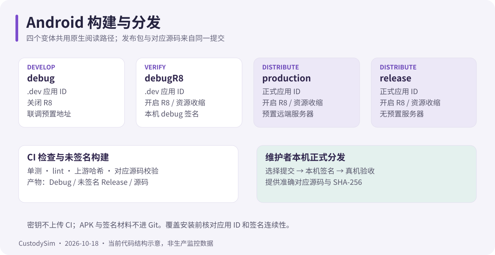

# Android 文档中心

核对日期：2026-10-18。本仓库是当前 Android 日常工作位置；Web/API 在[独立主仓库](https://github.com/PDSB001/CustodySim)。

## 当前指南

| 文档                                      | 内容                                              |
| ----------------------------------------- | ------------------------------------------------- |
| [开发与发布](android-development.md)      | JDK / SDK、变体、配置、构建、覆盖安装与版本       |
| [CI](ci.md)                               | 检查项、运行取消、报告、未签名 APK 与对应源码     |
| [接口与行为](android-client.md)           | android-app/2、单飞刷新、聊天、阅读与 API 规格    |
| [阅读与缓存](reader-cache.md)             | 原生引擎、128 MiB 磁盘缓存、共享正文、gzip 和恢复 |
| [权限与定位](permissions.md)              | 前台服务类型、分阶段定位授权和后台限制            |
| [Gradle 构建缓存](android-build-cache.md) | build/configuration cache，如何诊断失效           |
| [许可与对应源码](../README-LICENSE.md)    | 分发与上游声明保留                                |

使用者请看 [Web 使用指南](https://github.com/PDSB001/CustodySim/blob/master/docs/user-guide.md)；运行时端点选择见[服务器设置](https://github.com/PDSB001/CustodySim/blob/master/docs/server-selection.md)。

维护工具见[脚本导航](../scripts/README.md)。

## 历史记录

历史材料已集中在 [archive](archive/README.md)。

以下记录保留当时的路径、变体、设备和结果，**不要直接复制旧命令作为当前流程**：

- [独立仓库迁移](archive/repository-migration.md)
- [仓库拆分计划](archive/android-stabilization-and-repo-split.md)
- [阅读器翻页方案](archive/android-reader-pagination-refactor.md)
- [Episteme 接入](archive/android-episteme-integration.md)
- [历史原生规格与事故](archive/android-client-legacy.md)
- [性能复测](archive/android-performance.md)
- [Miuix 改造](archive/android-ui-refactor.md)
- [玻璃材质试点](archive/android-glass-pilot.md)
- [警告清理](archive/android-warning-audit.md)
- [API 37 适配记录](archive/android-target-api-37.md)

修改服务端契约须同步双仓文档与回归；修改上游代码用 vendor 脚本更新 UPSTREAM.json。私有配置、密钥、APK、缓存和真实用户截图不入 Git。图解是结构说明，不能当作真机性能数据。
