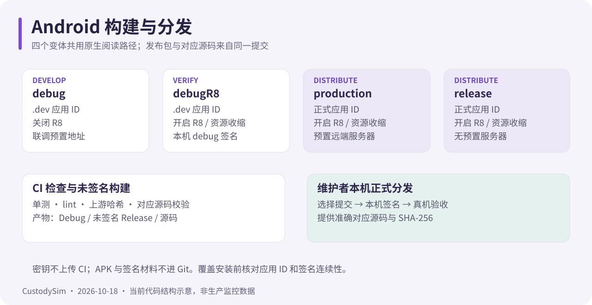

# Android 文档中心

CustodySim 的 Android 客户端（Kotlin + Compose + Miuix）与 Web / API 分仓维护，本目录只覆盖 **App 侧**：构建发布、CI、网络与实时契约、阅读缓存、权限定位、通知推送、交互与协议阅读、依赖升级。

> 本页核对日期：**2026-11-01**。源码版本 **1.7.0 / versionCode 5**，安装包与 App Release 后续发布；版本以 [app/build.gradle.kts](../app/build.gradle.kts) 为准，本目录不再重复维护版本号表。

## 按任务进入

| 我要做什么                     | 文档                                                    |
| ------------------------------ | ------------------------------------------------------- |
| 第一次把项目跑起来             | [开发与发布](android-development.md)                    |
| 打 Debug / Release / 正式包    | [开发与发布](android-development.md) · [CI](ci.md)      |
| 查构建慢、缓存失效、配置缓存报错 | [构建缓存](android-build-cache.md)                    |
| 改接口解析、登录刷新、实时聊天 | [接口与行为](android-client.md)                         |
| 改阅读器、正文下载、缓存       | [阅读与缓存](reader-cache.md)                           |
| 改定位、后台运行、权限引导     | [权限与定位](permissions.md)                            |
| 改推送、厂商通道、通知开关     | [App 通知与推送](push-notifications.md)                 |
| 改通知弹层、计分板、任务分类   | [通知、计分板与任务分类交互](ui-interactions.md)        |
| 升级依赖、判断兼容风险         | [依赖升级记录](dependency-upgrades.md)                  |
| 分发 APK、准备对应源码         | [许可与分发](../README-LICENSE.md) · [开发与发布](android-development.md) |

脚本用途见[脚本导航](../scripts/README.md)。服务端完整协议、法务文本与站点规则在 [Web 仓库](https://github.com/PDSB001/CustodySim)，本仓不复制一份容易漂移的 API 文档。

## 跨仓边界

| 内容                                       | 权威位置                                                     |
| ------------------------------------------ | ------------------------------------------------------------ |
| 服务端接口、鉴权、`nativeProtocol` 区间    | Web 仓库 `docs/android-client.md`（原生接入规格）            |
| 用户协议与隐私政策正文                     | Web 仓库 `lib/legal-version.ts` 与站点页面，经同步脚本进 App |
| 阅读计时、积分、图书馆规则                 | Web 仓库 `docs/library.md`、`docs/scoring.md`                |
| 推送投递与厂商通道配置                     | Web 仓库 `docs/app-push.md`，本仓只记录客户端一侧            |
| Android 构建、签名、缓存、权限、交互        | 本仓库                                                       |

只改一侧会静默降级：改了请求字段却不改服务端兼容解析，或改了服务端响应却不确认旧 App 仍能运行，都属于不完整改动。

## 文档状态约定

- **当前文档**（本目录 9 篇 + 本页）描述现状；页首有核对日期，与代码不一致时以代码和构建文件为准。
- **未验收事项**集中写在[交互文档的验证矩阵](ui-interactions.md#待设备验证矩阵)与[权限与定位的验证清单](permissions.md#如何验证)，文档写完不等于真机验证通过。
- **历史材料**在 [archive/](archive/README.md)：拆分前的 worktree、benchmark、H5 阅读器、性能与 UI 重构过程。命令、数字与结论都只代表当时环境。
- 不再在文档中固定单元测试条数；数量随代码变化，查看 [CI](ci.md) 的实际运行结果。

## 协议与隐私相关入口

- App 内阅读《用户协议》《隐私政策》：登录页底部、以及「我的 → 用户协议与隐私政策」；正文随安装包离线保存，版本与生效日期显示在正文顶部。
- 正文由 `scripts/sync-legal-documents.mjs` 从 Web 仓库导出，发布前用 `--check` 核对标题、版本、生效日期与全文。
- 阅读协议不会记录同意、不会开启通知或定位权限；注册与同意记录只发生在 Web。

## 历史归档

| 记录                                                                                     | 内容                             |
| ---------------------------------------------------------------------------------------- | -------------------------------- |
| [归档索引](archive/README.md)                                                             | 全部历史文档的分类与阅读方法     |
| [仓库拆分与迁移](archive/repository-migration.md) · [稳定化](archive/android-stabilization-and-repo-split.md) | 从 Web 子树迁出、构建边界    |
| [Episteme 集成](archive/android-episteme-integration.md) · [分页重构](archive/android-reader-pagination-refactor.md) | 阅读内核的引入与改造 |
| [性能](archive/android-performance.md) · [警告审计](archive/android-warning-audit.md) · [target API 37](archive/android-target-api-37.md) | 测量与整改记录 |
| [旧客户端规格](archive/android-client-legacy.md)                                          | 已删除的 worktree / benchmark / H5 路径 |

## 维护规则

1. 改构建变体、签名、端点注入方式时，同时更新[开发与发布](android-development.md)与[构建缓存](android-build-cache.md)的失效条件。
2. 改请求头、刷新逻辑或实时协议时，先改 Web 侧契约与兼容回归，再更新[接口与行为](android-client.md)，并递增 `android-app/N` 的结尾数字。
3. 改权限或后台调度时，同步 Manifest、[权限与定位](permissions.md)与商店申报说明；不要为了消除提示删除仍在使用的权限。
4. 改可见交互时，在[交互文档](ui-interactions.md)记录动画、触控区与减少动效策略，并把未在真机确认的项留在待验证矩阵。
5. 文档示例不写真实服务器地址、账号、令牌、AppKey、华为 App ID 或日志原文；私有配置只放在被忽略的 `local.properties`、`push.local.properties` 或 CI Secret 之外的本机环境。
6. 新增文件先确认归属：App 源码在 `app/`，阅读内核在 `episteme-core/`，脚本在 `scripts/`，历史材料进 `archive/`。
