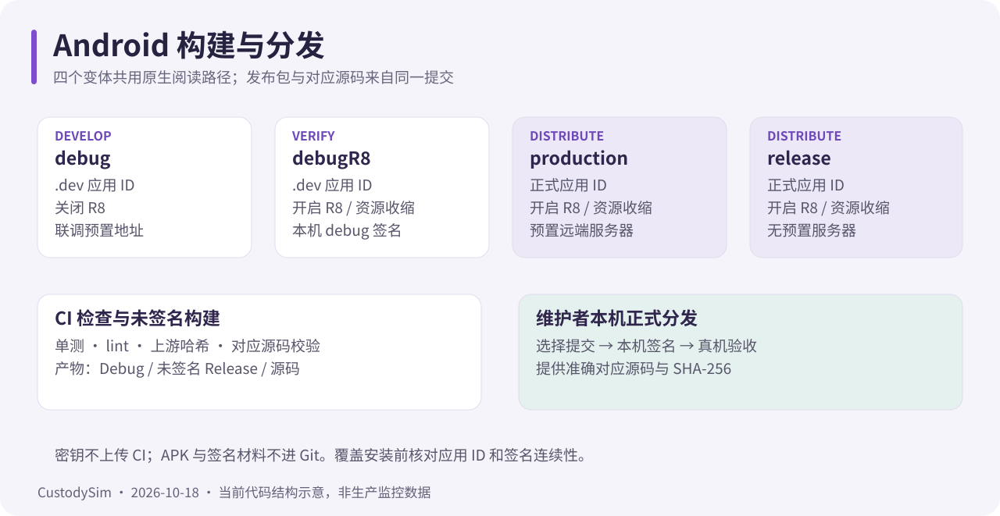

# Android 开发与发布

核对日期：2026-11-01。所有命令从 **CustodySim-app 仓库根目录**执行；不需要 Web 仓库的旧 `.app-workspace` 或同步脚本。



## 工具链

| 项目                | 当前仓库配置                                     |
| ------------------- | ------------------------------------------------ |
| JDK                 | 17（CI 用 Temurin 17，Java 编译目标 17）         |
| Gradle wrapper      | 9.8.2                                            |
| AGP / Kotlin        | 9.4.1 / 2.4.21（AGP 9 内置 Kotlin）              |
| Compose BOM / Miuix | 2026.09.00 / 0.9.4                               |
| Android SDK         | min 26 / compile 37 / target 37，build-tools 37.0.0 |
| ABI                 | arm64-v8a、armeabi-v7a（不含 x86 / x86_64）      |
| 源码版本            | 1.7.0 / versionCode 5（安装包后续发布）          |

以 [版本目录](../gradle/libs.versions.toml)、[wrapper](../gradle/wrapper/gradle-wrapper.properties) 和 [App 构建文件](../app/build.gradle.kts) 为准。始终使用仓库 wrapper，不要换成本机另一套 Gradle。

## 构建变体

| 变体       | 应用 ID                | R8 / 资源收缩 | 默认服务器                     | 签名                |
| ---------- | ---------------------- | ------------- | ------------------------------ | ------------------- |
| debug      | com.custodysim.app.dev | 关闭          | 私有联调配置                   | 本机 debug 签名     |
| debugR8    | com.custodysim.app.dev | 开启          | 同 debug，非 debuggable        | 本机 debug 签名     |
| production | com.custodysim.app     | 开启          | 预置远端，可私有覆盖           | 当前绑定本机 debug 签名 |
| release    | com.custodysim.app     | 开启          | 不嵌入端点                     | 未配置，产物未签名  |

- 只有这四个变体；没有 development、benchmark、H5 开关，也没有 WebView 回退。四种变体的 EPUB/DOCX 都走 Episteme，TXT/PDF 走原生引擎。
- **production 目前显式复用 `debug` 签名配置**，因此可以直接覆盖安装做真机验证；但 debug 密钥不是发布密钥，正式对外分发必须用维护者签名重新构建，并核对与历史安装包的签名连续性，否则用户无法升级。
- 端点用简单异或编码写进 BuildConfig，只降低直接阅读便利性，不保护密钥；运行时地址仍可还原。release 忽略所有端点预置，production 未覆盖时使用构建文件里的远端默认值与由其推导的 WSS 地址。
- 运行时服务器选择只接受 HTTPS 根地址，保存后清本机旧凭据，详见 [Web 服务器设置](https://github.com/PDSB001/CustodySim/blob/master/docs/server-selection.md)。

## 私有构建配置

私有配置全部不入库。`local.properties` 至少要有 `sdk.dir`；端点优先读 `local.properties`，缺省再读环境变量：

| local.properties                 | 环境变量                           | 生效变体      |
| -------------------------------- | ---------------------------------- | ------------- |
| `custodysim.baseUrl`             | `CUSTODYSIM_BASE_URL`              | debug / debugR8 |
| `custodysim.realtimeUrl`         | `CUSTODYSIM_REALTIME_URL`          | debug / debugR8 |
| `custodysim.productionBaseUrl`   | `CUSTODYSIM_PRODUCTION_BASE_URL`   | production    |
| `custodysim.productionRealtimeUrl` | `CUSTODYSIM_PRODUCTION_REALTIME_URL` | production |
| `custodysim.localNetwork`        | 无                                 | 可选，联调本地网络判定 |

```properties
sdk.dir=C\:\\Users\\<user>\\AppData\\Local\\Android\\Sdk
custodysim.baseUrl=http://192.168.1.100:3000
custodysim.realtimeUrl=ws://192.168.1.100:3001
```

推送与华为参数见 [App 通知与推送](push-notifications.md)：友盟走 `custodysim.umengAppKey` / `custodysim.umengMessageSecret`，华为走 `push.local.properties` 或 `CUSTODYSIM_HUAWEI_APP_ID`；FCM 走本地 `app/google-services.json`。缺少 Firestore 配置时 Google Services 任务会清空旧生成资源并跳过，而不是沿用上次的参数。

### 明文与网络安全配置

`debug` / `debugR8` 构建时，`GenerateNetworkSecurityConfig` 任务按配置的 `http://` / `ws://` 主机生成 `network_security_config.xml`，只放行这些具体域名（`includeSubdomains=false`）；其余仍禁止明文。`release` / `production` 使用基础配置，全面禁止明文。改端点后必须重新构建，缓存里的旧配置不会自动更新。

## 构建、检查与安装

```powershell
.\gradlew.bat :app:assembleDebug
.\gradlew.bat :app:assembleDebugR8
.\gradlew.bat :app:assembleProduction
.\gradlew.bat :app:assembleRelease

.\gradlew.bat :app:testDebugUnitTest
.\gradlew.bat :app:lintDebug
.\gradlew.bat :app:compileDebugAndroidTestKotlin
```

Bash 把 `.\gradlew.bat` 换成 `./gradlew`。JVM 单测、androidTest 编译、真实设备 instrumented 测试是三种不同检查，不能互相替代。

| 产物                | 路径                                             |
| ------------------- | ------------------------------------------------ |
| APK                 | `app/build/outputs/apk/<变体>/`                  |
| R8 mapping          | `app/build/outputs/mapping/<变体>/`              |
| 报告                | `app/build/reports/`（lint、测试）               |
| 对应源码 ZIP        | `build/distributions/`                           |

安装用 `adb install -r <实际APK路径>`，先核对包名与签名：debug 与 debugR8 同 `.dev` 包名、同 debug 签名，可互相覆盖；正式包必须保持签名连续。排查问题不要用卸载或清数据掩盖升级问题。

## 发布流程

1. 在本仓库确认改动与版本（`versionCode` 必须增长），提交并等 [CI](ci.md) 通过。
2. 用维护者签名构建正式包；仓库不提供发布密钥，也不把密钥交给 CI。
3. 从同一源码版本生成并校验准确对应源码：

   ```powershell
   .\gradlew.bat androidCorrespondingSource
   node scripts/verify-source-archive.mjs
   ```

   校验脚本需要 `unzip` 在 PATH；Windows 可用 Git for Windows 的 `usr/bin/unzip.exe`。
4. 记录 APK、源码 ZIP 与提交的对应关系及 SHA-256，按[许可说明](../README-LICENSE.md)一起分发；组合应用按 AGPL-3.0-only 提供对应源码。
5. 在真实设备复验登录与刷新、覆盖升级、聊天重连、四种图书阅读、阅读计时、定位授权、后台与通知；CI 与编译通过都不证明这些行为。

## 常见故障

| 现象                                       | 处理                                                                 |
| ------------------------------------------ | -------------------------------------------------------------------- |
| `SDK location not found`                   | 在 `local.properties` 补 `sdk.dir`，不要提交该文件                   |
| debug 包连不上联调服务器                   | 确认 `custodysim.baseUrl/realtimeUrl` 为 http/ws 且与手机同网段      |
| 写请求全 403                               | 服务端要求可信来源，App 必须携带 `X-CustodySim-Client: android-app/2` |
| Firebase 相关任务显示 skipped              | 该变体没有匹配包名的 `google-services.json`，属预期；需要时补配置    |
| R8 后启动崩溃                              | 保留 mapping，核对被裁掉的反射入口，不要直接关闭 R8 交付             |
| `INSTALL_FAILED_UPDATE_INCOMPATIBLE`       | 签名或包名不一致；不要用卸载掩盖，先对齐签名来源                     |

签名材料、私有端点、`local.properties`、`push.local.properties`、APK、构建缓存与日志都不入 Git，也不上传到 CI。
