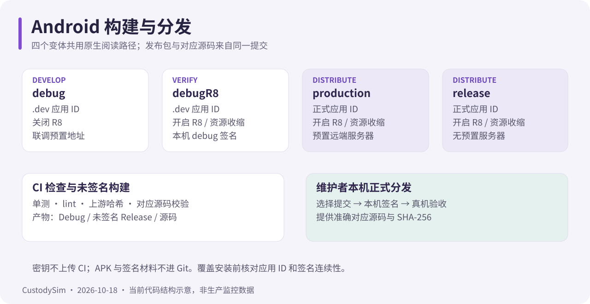

# Android CI

核对日期：2026-11-01。入口 [.github/workflows/ci.yml](../.github/workflows/ci.yml)，工具链在 [setup-android](../.github/actions/setup-android/action.yml)。正式 APK 由维护者本机签名，CI 不保存发布密钥或私有服务端配置。

## 触发与权限

| 项       | 配置                                                       |
| -------- | ---------------------------------------------------------- |
| 触发     | `pull_request`、推送到 `main`、手动运行、`workflow_call`   |
| 权限     | 仅 `contents: read`                                        |
| 并发     | 同一 workflow + ref 组内 `cancel-in-progress: true`        |
| 运行环境 | `ubuntu-24.04`，超时 40 分钟，单 Job 名 `Android CI gate`  |
| 依赖版本 | Actions 全部按提交 SHA 固定，Dependabot 每周检查           |

建议把 `Android CI gate` 设为必需检查；它不依赖外部服务或密钥，PR 只用只读缓存。

## 环境

- Temurin **JDK 17**（`actions/setup-java@v5`），`gradle/actions/setup-gradle@v4` 管理 Gradle 缓存：`main` 可写，其余分支 `cache-read-only`。
- `sdkmanager` 安装 `platforms;android-37.0` 与 `build-tools;37.0.0`，并使用仓库 wrapper（9.8.2）。

## 检查步骤

1. `bash scripts/check-workflows.sh`：workflow 静态检查（YAML、权限与脚本引用）。
2. `node scripts/verify-episteme.mjs`：核对导入阅读核心 `episteme-core/UPSTREAM.json` 的 22 个文件哈希。
3. `./gradlew :app:testDebugUnitTest :app:lintDebug :app:assembleDebug :app:assembleRelease androidCorrespondingSource --no-daemon --console=plain`
4. `node scripts/verify-source-archive.mjs`：核对源码 ZIP 必需文件并拒绝私有材料。
5. 校验未签名 Release 存在，收集 Debug / 未签名 Release / 源码 ZIP，写入 `COMMIT.txt` 并生成 `SHA256SUMS`。

CI 只构建 `debug` 与 `release`：**不构建 `production`，也不构建 `debugR8`**。R8 相关问题需要本机跑 `assembleDebugR8` / `assembleProduction` 补验。

## 产物

| 名称                        | 内容                                                                | 保留 |
| --------------------------- | ------------------------------------------------------------------- | ---- |
| `android-reports-*`         | `app/build/reports`（lint、测试报告）与 `app/build/test-results`    | 7 天 |
| `android-build-{commit}`    | Debug APK、未签名 Release、对应源码 ZIP、`COMMIT.txt`、`SHA256SUMS` | 14 天 |

报告在失败时也尽量上传（`if: always()`，缺失不报错）；构建产物缺失则直接失败。未签名 Release 不能当正式分发包装机使用。

## Lint 策略

`warningsAsErrors = true`。仅按构建文件排除四项：`GradleDependency`、`NewerVersionAvailable`、`AndroidGradlePluginVersion`（依赖新鲜度属于受审查的升级流程，见[依赖升级](dependency-upgrades.md)）与 `LogNotTimber`（阅读内核依赖 Timber，App 侧刻意使用 Android Log）。

其余任何新增告警都会阻断 CI。不要新增全局 baseline 掩盖问题。

## 失败怎么查

| 失败点              | 处理                                                                 |
| ------------------- | -------------------------------------------------------------------- |
| workflow 静态检查   | 按脚本输出修 YAML、权限或引用路径，不要绕过                       |
| 哈希校验            | 用 `scripts/vendor-episteme-core.mjs` 重新导入并更新清单，不手改哈希 |
| 单测                | 先看 `app/build/test-results/testDebugUnitTest/` 的失败用例           |
| Lint                | 看 `app/build/reports/lint-results-debug.html` 的具体位置与说明      |
| R8 / 打包           | 核对真实报错与受影响变体，保留 mapping；Debug 通过不能替代 Release   |
| 源码归档            | 核对版本、必需脚本、许可证，以及是否误带本机文件                     |

本机跑归档校验需要 `unzip` 在 PATH；Windows 可用 Git for Windows 的 `usr/bin/unzip.exe`。

## 边界

CI 证明的是“能编译、测试通过、Lint 干净、源码可归档”。它不证明真实设备的手势与帧率、后台定位成功率、厂商通道送达、签名连续性，也不发布 APK。发布前按[开发与发布](android-development.md)在本机完成签名、设备复验与分发材料准备。
