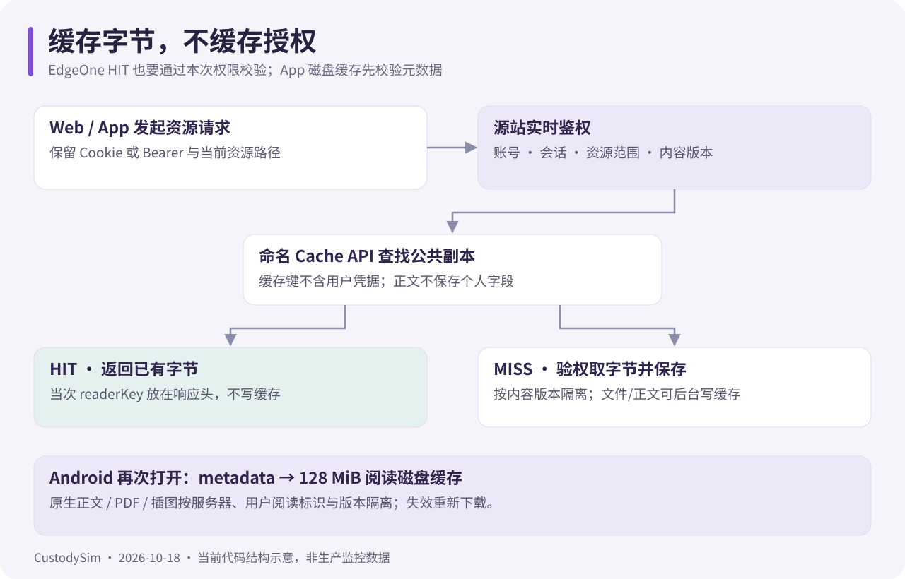

# 原生阅读与缓存

核对日期：2026-10-18。服务端完整规则见 [Web 图书馆](https://github.com/PDSB001/CustodySim/blob/master/docs/library.md)。

## 三种原生引擎

| 格式        | 引擎              | 内容来源                       |
| ----------- | ----------------- | ------------------------------ |
| EPUB / DOCX | Episteme          | 净化章节、样式、目录与可用插图 |
| TXT         | StaticLayout 文本 | 服务端 Unicode 文本            |
| PDF         | PdfRenderer       | 原始 PDF 文件                  |

不存在 WebView 回退。原生排版、设备字体和视口可能使视觉页不同，仍遵守服务端阅读位置合约；样式保真能力不等于完整复刻原电子书。

## 每次开书发生什么

1. GET /api/library/{id}/document?metadata=1，在线校验会话、访问范围、readerKey 和 revision。
2. 根据服务器来源、用户阅读标识与内容版本查 128 MiB 阅读磁盘缓存。
3. 命中有效正文 / PDF / 插图时复用；损坏条目校验失败被丢弃，重新下载。
4. 没有正文缓存时携带 X-CustodySim-Reader-Delivery: shared-v1，允许 EdgeOne 返回公共正文。
5. 核对当次 readerKey/revision；根据实际 gzip 文件头解码，保存完整个人文档。旧服务器个人 JSON 保持兼容。

这不是完全离线图书馆：开书仍需要 metadata 权限验证，不能因设备有副本跳过登录、下架或版本检查。已下载字节不能远程收回；缓存也可能被系统回收。

## 不要混淆缓存层

| 缓存                   | 容量 / 行为                                            |
| ---------------------- | ------------------------------------------------------ |
| ReaderDiskCache        | 默认 128 MiB；应用私有目录，校验和、原子写入与容量淘汰 |
| OkHttp HTTP Cache      | 25 MiB；遵循 HTTP 缓存头，不保存 no-store              |
| 图像加载内存缓存       | 图片解码与当前进程复用；不是整本书磁盘缓存             |
| EdgeOne 命名 Cache API | 原文件、插图与公共正文 7 天；每次实时鉴权              |

书籍/用户/源站/版本不同不会复用同一个阅读条目，插图还包括规范化路径。同一键在途请求协调复用；取消的页面不发布迟到正文或缓存结果。文件替换产生新 revision，旧位置与会话按服务端规则处理。

代码入口：[LibraryReaderRepository](../app/src/main/java/com/custodysim/app/ui/library/LibraryReaderRepository.kt)、[ReaderDiskCache](../app/src/main/java/com/custodysim/app/ui/library/ReaderDiskCache.kt)、[ApiClient](../app/src/main/java/com/custodysim/app/data/net/ApiClient.kt)、[ReaderDocumentTransport](../app/src/main/java/com/custodysim/app/data/net/ReaderDocumentTransport.kt)。

## 恢复与计时

网络、gzip/JSON 或共享身份异常，以及 5xx，仅尝试一次 /document-origin；401/403/404 和主动取消不恢复。恢复路径重新鉴权，不能被 EdgeOne document* 触发规则再次拦截。

正文加载失败时停止计时。前台 RESUMED、未暂停且有有效服务器心跳才累计阅读；每 15 秒串行上报，服务端接受的连续片段不超过 25 秒，离线不补记。打开设置、离开前台与结束会话按当前 UI 生命周期处理。

## 实机验收与排障

用同一本书分别记录首次下载、再次打开、metadata 等待、解析和首屏排版。二次打开没有整本 /document 或 /file 下载、仍有 metadata，是正常缓存行为。命中不保证网络鉴权和排版立即完成。

检查 EPUB/DOCX 中文与插图、PDF 缩放、TXT 页码、断网/取消、换账号服务器、替换正文和书籍下架；读取缓存不应增加离线时长。编译与 JVM 测试不能证明真实设备内存和滚动表现。
