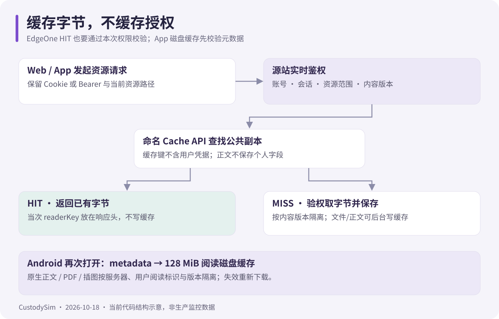

# 原生阅读与缓存

核对日期：2026-11-01。服务端的完整阅读规则见 Web 仓库 [图书馆与有效阅读](https://github.com/PDSB001/CustodySim/blob/master/docs/library.md)，边缘缓存配置见 [EdgeOne 缓存](https://github.com/PDSB001/CustodySim/blob/master/docs/edgeone-media-cache.md)。

## 三种原生引擎

| 格式        | 引擎              | 内容来源                       |
| ----------- | ----------------- | ------------------------------ |
| EPUB / DOCX | Episteme          | 净化后的章节、样式、目录与插图 |
| TXT         | StaticLayout 文本 | 服务端 Unicode 文本            |
| PDF         | PdfRenderer       | 原始 PDF 文件                  |

没有 WebView 回退。原生排版、设备字体与视口会让“视觉页”与网页版不同，但阅读位置仍遵守服务端合约；样式保真能力也不等于完整复刻原始电子书。

## 每次开书发生什么

1. `GET /api/library/{id}/document?metadata=1`：在线校验会话、访问范围、`readerKey` 与 `revision`。
2. 用“服务器来源 + 用户阅读标识 + 内容版本”查 128 MiB 阅读磁盘缓存。
3. 正文 / PDF / 插图命中且校验通过时直接复用；校验失败或残缺的条目丢弃并重新下载。
4. 没有正文缓存时携带 `X-CustodySim-Reader-Delivery: shared-v1`，允许 EdgeOne 返回公共正文。
5. 核对响应中的 `readerKey` 与 `revision` 是否与本次请求一致，再按实际 gzip 文件头解码，保存完整个人文档；旧服务端的个人 JSON 形态仍可读取。

这不是完全离线图书馆：开书仍要在线验证元数据，不能因为设备上有副本就跳过登录、下架或版本检查。已下载的字节无法远程收回，缓存也可能被系统清理。

## 不要混淆缓存层

| 缓存                     | 容量 / 行为                                                  |
| ------------------------ | ------------------------------------------------------------ |
| ReaderDiskCache          | 默认 128 MiB；应用私有目录，校验和、原子写入、按容量淘汰     |
| OkHttp HTTP Cache        | 25 MiB；严格遵循响应头，`no-store` 不落盘                    |
| 图像内存缓存             | 解码位图与当前进程复用，不是整本书的磁盘副本                 |
| EdgeOne 命名 Cache API   | 原文件、插图与公共正文按 7 天缓存，但每次仍实时鉴权          |

书籍、用户、源站、版本任一不同都不会复用同一条阅读缓存；插图还包含规范化路径。同一键的在途请求会合并，被取消的页面不发布迟到正文或缓存结果。正文替换产生新 `revision` 后，旧位置的恢复按服务端规则处理。

代码入口：[LibraryReaderRepository](../app/src/main/java/com/custodysim/app/ui/library/LibraryReaderRepository.kt)、[ReaderDiskCache](../app/src/main/java/com/custodysim/app/ui/library/ReaderDiskCache.kt)、[ApiClient](../app/src/main/java/com/custodysim/app/data/net/ApiClient.kt)、[ReaderDocumentTransport](../app/src/main/java/com/custodysim/app/data/net/ReaderDocumentTransport.kt)。

## 恢复与计时

- 网络异常、gzip/JSON 损坏、共享身份不一致与 5xx，只尝试一次 `/document-origin`；401/403/404 与主动取消不恢复。恢复请求重新鉴权，且不能被 EdgeOne 的 `document*` 公共缓存规则再次命中。
- 正文加载失败立即停止计时。只有前台 `RESUMED`、未被暂停且有有效服务器心跳时才累计阅读时间；每 15 秒串行上报一次，服务端接受的连续片段不超过 25 秒，离线不补记。
- 打开设置、切后台、结束会话都按当前 UI 生命周期结算，不做“后台继续计时”。

## 实机验收与排障

同一本书分别记录：首次下载、二次打开、metadata 等待、解析耗时、首屏排版。二次打开**没有**整本 `/document` 或 `/file` 下载、但仍有 metadata 请求，是正常的缓存行为；命中缓存也不代表网络鉴权与排版立即完成。

| 场景             | 期望                                                     |
| ---------------- | -------------------------------------------------------- |
| EPUB / DOCX      | 中文断行、目录、插图与代码块正常；无 WebView 痕迹        |
| PDF              | 缩放与翻页稳定，页码与服务端位置一致                     |
| TXT              | 大文件分页不卡死，页码与服务端位置一致                   |
| 断网 / 取消      | 正文加载失败即停止计时，不写半截缓存                     |
| 换账号 / 换服务器 | 不串用他人缓存，旧队列清理                               |
| 正文替换         | 新 `revision` 生效，旧位置按服务端规则恢复或提示         |
| 书籍下架         | 元数据校验失败即拒绝打开，即使本机有副本                 |

读取缓存不能增加离线可用时长；编译与 JVM 测试也不能证明真实设备的内存与滚动表现。
